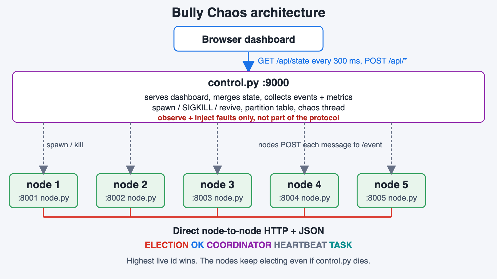

# Bully Chaos: Self-Healing Leader Election

Bully Chaos runs N real node processes (default 5) on one machine. The nodes elect the highest-id live node as leader with the Bully algorithm (ELECTION, OK and COORDINATOR messages) and detect a dead leader through heartbeat timeouts. A web dashboard lets you kill and revive nodes, split the network in two, and switch on a Chaos-Monkey-style random killer while the cluster heals itself.

## How to run

```
./run.sh
```

This is the same as `python3 control.py --nodes 5 --slow 2`. Then open http://localhost:9000 in a browser.

Self-check (drives the control API and asserts each scenario; needs the cluster from `./run.sh` or its own control.py running):

```
python3 scenarios.py
```

## Dependencies

- python3 >= 3.10, standard library only. No pip install, no CDN: the dashboard also works offline.

## Architecture

- Each node is a separate OS process (`node.py`) running a small HTTP + JSON server on ports 8001 to 800N. Nodes talk to each other directly with ELECTION / OK / COORDINATOR / HEARTBEAT / TASK messages.
- `control.py` (port 9000) spawns and SIGKILLs the node processes, serves the dashboard, injects faults (network split, chaos thread) and collects events and metrics. It only observes and injects faults; it is not part of the protocol, so the nodes keep electing if it dies.
- A follower whose heartbeat deadline passes starts an election; the highest live id wins, and the id alone decides.
- `static/index.html` polls `GET /api/state` every 300 ms and draws a live space-time diagram (one lane per node, slanted message arrows), the event log and metrics.



## Scenarios

1. Baseline: the highest-id node becomes leader at startup.
2. Leader crash: kill the leader, followers detect it by heartbeat timeout and elect a new one.
3. Old leader returns: the revived higher-id node bullies its way back as leader.
4. Low-id node returns: it asks `/whois`, finds the leader and joins without an election.
5. Double crash: kill the top two nodes together; the next highest takes over.
6. Simultaneous detection: two nodes notice the failure at once; the cluster still ends with one leader (happens naturally during chaos).
7. Crash mid-election: the candidate dies during the election; the OK timeout fires and the election restarts.
8. Split brain and heal: a network split gives two leaders; after Heal, one leader remains.
9. Chaos Monkey: random kills and revives every few seconds while metrics are recorded.

## Timing constants

Constants at the top of `node.py`; `--slow` multiplies them by 2 for video pacing.

| Constant | Default | Meaning |
|---|---|---|
| `HB_INTERVAL` | 1.0 s | leader sends a heartbeat this often |
| `T_HB_DEAD` | 3.0 s | follower starts an election if no heartbeat arrives in this time |
| `T_OK` | 1.5 s | candidate waits this long for an OK from a higher node before declaring itself leader |
| `T_COORD` | 3.0 s | after an OK, wait this long for a COORDINATOR before restarting the election |

## Group details

See `group_details.txt`.

- Group number: TODO
- Project title: Bully Chaos: Self-Healing Leader Election
- Members (name, roll number): TODO
